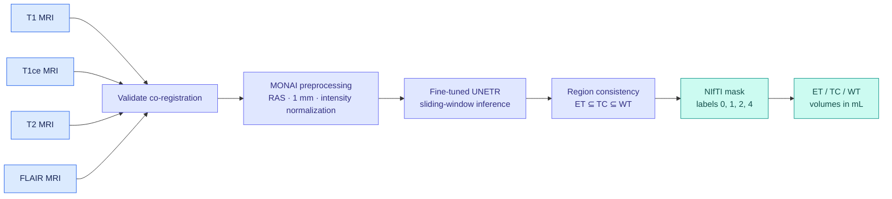
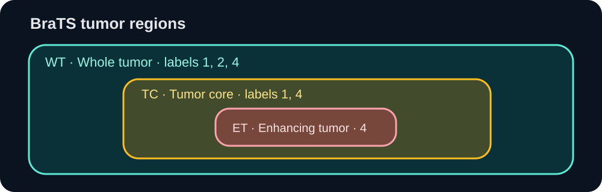
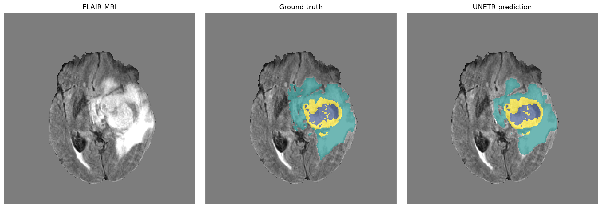
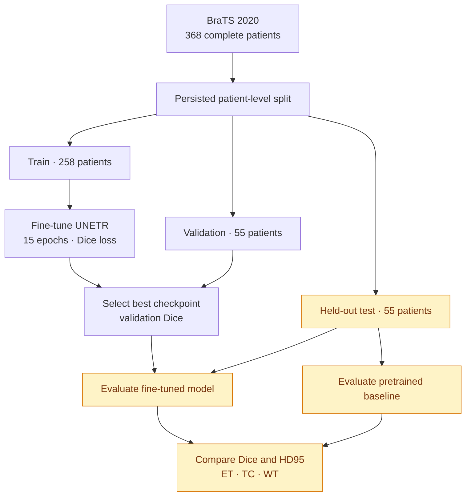
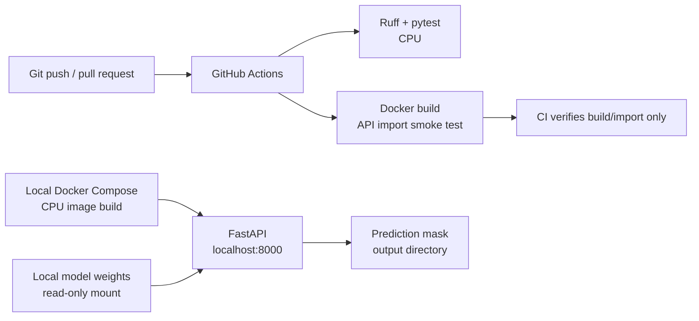

<div align="center">

# 🧠 Brain Tumor MRI Segmentation

**UNETR · PyTorch · MONAI · FastAPI · Docker · GitHub Actions**

[](https://github.com/Anziya25/brain-tumor-segmentation/actions/workflows/ci.yml)


*Research-grade engineering demo for multimodal MRI segmentation, model evaluation, and containerized inference.*

[Overview](#what-the-project-does) · [Pipeline](#visual-pipeline) · [Quick start](#quick-start) · [API](#run-the-api-locally) · [Training](#training-and-evaluation) · [CI](#quality-checks-and-ci)

</div>

> ⚠️ **Research/portfolio use only.** Not a medical device; not validated for diagnosis, treatment, or clinical decision-making.

## Visual pipeline



### Tumor region hierarchy



The diagram illustrates **logical region containment**, not an actual patient scan or a measured model output.

## Example segmentation output



*Example MRI slice with ground-truth and model-predicted tumor regions. This is a qualitative illustration, not an independent held-out performance result.*

## Quick start

<details>
<summary><strong>🧪 Run linting and automated tests (no MRI data or model weights required)</strong></summary>

```bash
python -m venv .venv
# Activate the environment first; on Windows PowerShell use .venv\Scripts\Activate.ps1
python -m pip install torch==2.8.0 --index-url https://download.pytorch.org/whl/cpu
python -m pip install -r requirements-cpu.txt
python -m pip install ruff==0.11.13
python -m ruff check app tests
python -m pytest tests/ -v
```

</details>

<details>
<summary><strong>🐳 Build and smoke-test the CPU Docker image</strong></summary>

```bash
docker compose config --quiet
docker build -t brain-tumor-segmentation:local .
docker run --rm brain-tumor-segmentation:local python -c "import app.main; print('Docker API import OK')"
```

This tests the image and API import; **it does not run a real MRI prediction**.

</details>

<details>
<summary><strong>🧠 Run actual MRI inference (model assets required)</strong></summary>

1. Supply the authorized pretrained model implementation and weights in `models/unetr-brats/`.
2. Supply your trusted `models/finetuned_unetr_fresh.pth` for the GPU Compose configuration (or `models/finetuned_unetr.pth` for the legacy/default service).
3. Start the API with `docker compose up --build` or the local Uvicorn command below.
4. Submit four **already co-registered** NIfTI volumes to `POST /predict`.

</details>

## Training and evaluation flow



## Deployment and CI



CI **does not deploy** the API. Running Docker Compose locally is a separate, user-initiated step.

## What the project does

Four **co-registered 3D MRI volumes** are required per case: T1, contrast-enhanced T1 (**T1ce**), T2, and FLAIR. The inference pipeline validates that all four volumes have compatible shapes and physical-space grids. It **does not perform image registration**.

Preprocessing uses MONAI to load the volumes, orient them to RAS, resample to 1 mm isotropic spacing, clip intensities to the 0.5–99.5 percentiles, normalize nonzero intensities, and concatenate modalities into a four-channel image. The model runs patch-based sliding-window inference using 128 × 128 × 128 patches with 25% overlap.

The three predicted regions are:

| Region | Meaning | BraTS labels in final mask |
| --- | --- | --- |
| ET | Enhancing tumor | 4 |
| TC | Tumor core | 1, 4 |
| WT | Whole tumor | 1, 2, 4 |

Independent region predictions are corrected to satisfy **ET ⊆ TC ⊆ WT** before they are converted to a single NIfTI label map. Region volumes are computed **from the saved label map** using the physical voxel volume derived from its affine, and reported in mL.

<details>
<summary><strong>📁 Explore the repository components</strong></summary>

## Repository components

| Path | Purpose |
| --- | --- |
| `app/train.py` | Fine-tune pretrained UNETR and select a checkpoint by validation Dice |
| `app/evaluate.py` | Compare baseline and fine-tuned models on a held-out test split using Dice and HD95 |
| `app/datalist.py` | Discover BraTS 2020 training cases |
| `app/data_splits.py` | Persist and validate patient-level train/validation/test splits |
| `app/preprocessing.py` | Training/inference transforms and MRI geometry validation |
| `app/inference_service.py` | Load model weights, run inference, save masks and calculate volumes |
| `app/main.py` | FastAPI endpoints and upload/output safeguards |
| `app/export_onnx.py`, `app/benchmark_onnx.py` | ONNX export and comparison utilities |
| `tests/` | Automated correctness, API, geometry, integration, split, and device tests |
| `.github/workflows/ci.yml` | CPU lint/tests and Docker build smoke test |
| `Dockerfile`, `docker-compose.yml` | Default CPU deployment |
| `Dockerfile.gpu`, `docker-compose.gpu.yml` | Optional NVIDIA GPU deployment |

</details>

## Requirements

- Python **3.11**
- PyTorch **2.8.0**
- Dependencies in `requirements-cpu.txt` (CPU) or `requirements.txt` (GPU)
- The pretrained model implementation and weights, plus the project's fine-tuned checkpoint, supplied separately
- BraTS-format data to run training or held-out evaluation

The repository intentionally excludes medical images and model weights. **Cloning alone is enough for code-level checks but not for actual MRI inference or training.**

## Local CPU setup

From the repository root:

```bash
python -m venv .venv
# Linux/macOS:
source .venv/bin/activate
# Windows PowerShell:
# .venv\Scripts\Activate.ps1

python -m pip install torch==2.8.0 --index-url https://download.pytorch.org/whl/cpu
python -m pip install -r requirements-cpu.txt
python -m pip check
python -m pip install ruff==0.11.13
python -m ruff check app tests
python -m pytest tests/ -v
```

The automated tests use synthetic fixtures and mocks where appropriate; they do not establish real-data segmentation quality.

## Dataset layout and splits

The training discovery code expects the **BraTS 2020 training dataset** under:

```text
data/
  brats20-dataset-training-validation/
    BraTS2020_TrainingData/
      MICCAI_BraTS2020_TrainingData/
        BraTS20_Training_001/
          BraTS20_Training_001_t1.nii
          BraTS20_Training_001_t1ce.nii
          BraTS20_Training_001_t2.nii
          BraTS20_Training_001_flair.nii
          BraTS20_Training_001_seg.nii
        ...
```

The **fresh fine-tuning experiment** used **368 complete BraTS 2020 patients** (258 train / 55 validation / 55 test; seed 42), with split manifest `models/patient_splits_fresh.json`. The older exploratory pipeline used up to 60 cases and `models/patient_splits.json`; these are separate experiments. Preserve the corresponding manifest to reproduce each run.

Use datasets only under their applicable access and licensing terms. Do not commit patient images or identifiable medical information.

## BraTS2020 data source and required citations

This project uses the **MICCAI BraTS 2020** MRI dataset, originally organized by the Center for Biomedical Image Computing and Analytics (CBICA), University of Pennsylvania. The repository owner obtained the local dataset via **Kaggle**; the exact Kaggle listing and dataset version have not yet been verified. The original challenge's [data description](https://www.med.upenn.edu/cbica/brats2020/data.html) and [data request and citation requirements](https://www.med.upenn.edu/cbica/brats2020/registration.html) are the primary sources for attribution and permitted uses.

The BraTS2020 organizers require citing **all three** of the following publications when using or referring to the challenge dataset:

1. Menze, B. H., Jakab, A., Bauer, S., et al. (2015). **The Multimodal Brain Tumor Image Segmentation Benchmark (BRATS).** *IEEE Transactions on Medical Imaging*, 34(10), 1993–2024. https://doi.org/10.1109/TMI.2014.2377694
2. Bakas, S., Akbari, H., Sotiras, A., et al. (2017). **Advancing The Cancer Genome Atlas glioma MRI collections with expert segmentation labels and radiomic features.** *Scientific Data*, 4, 170117. https://doi.org/10.1038/sdata.2017.117
3. Bakas, S., Reyes, M., Jakab, A., et al. (2018). **Identifying the Best Machine Learning Algorithms for Brain Tumor Segmentation, Progression Assessment, and Overall Survival Prediction in the BRATS Challenge.** *arXiv:1811.02629*. https://arxiv.org/abs/1811.02629

The organizers additionally recommend citing the underlying [TCGA-GBM](https://doi.org/10.7937/K9/TCIA.2017.KLXWJJ1Q) and [TCGA-LGG](https://doi.org/10.7937/K9/TCIA.2017.GJQ7R0EF) data records where publication rules permit. Research-use and citation guidance should **not** be interpreted as blanket permission to redistribute medical images or as confirmation of the Kaggle mirror's own terms. No MRI data are distributed in this repository.

## Training and evaluation

For the **60-case exploratory evaluation** (including measured results, case-level observations, and limitations), see **[Evaluation results](docs/EXPLORATORY_EVALUATION.md)**. The original checkpoint's training patient IDs are unknown, so these are **not held-out test results**.


These commands require the dataset and model assets described below.

```bash
python -m app.train
python -m app.evaluate
```

Training uses 128³ patches, AdamW, Dice loss, and validation Dice to select the fine-tuned checkpoint. The current configuration runs **15 epochs**; these are source-code settings, not a claim that a published experiment was reproduced.

The fresh pipeline runs `python -m app.train`, `python -m app.evaluate_fresh`, and `python -m app.audit_fresh`. Its 55-patient held-out test (disjoint from the fresh fine-tuning train and validation sets) reported **mean Dice 0.8294** for the fresh model versus **0.8153** for the upstream baseline; mean HD95 **8.73** versus **8.84** (evaluation units). The reproducibility audit passed **12/12** checks. Potential overlap with the upstream pretrained model’s training cases has **not** been excluded; these results are not independently verified external generalization. The legacy exploratory comparison is documented separately in `docs/EXPLORATORY_EVALUATION.md`; `app.evaluate` retains legacy-checkpoint evaluation functionality.

**Exploratory 60-case Dice (mean):** ET **0.8138**, TC **0.8971**, WT **0.8807**. Original training overlap is unknown; these are **not independent test accuracy**. [Methods, HD95 and limitations](docs/EXPLORATORY_EVALUATION.md).

## Model assets

The inference service expects:

```text
models/
  unetr-brats/
    inference.py
    pytorch_model.bin
    # other files required by the original pretrained model package
  finetuned_unetr.pth             # legacy checkpoint
  finetuned_unetr_fresh.pth       # fresh 368-patient experiment
  patient_splits.json            # legacy
  patient_splits_fresh.json      # fresh experiment
```

Obtain the pretrained implementation and checkpoint from the authorized original source and retain its license/attribution. The fine-tuned checkpoint must come from your trusted training workflow. **Do not load untrusted PyTorch checkpoint files**; model deserialization can execute unsafe code.

The service loads the fine-tuned weights on top of the pretrained architecture. Without these files, the API module can import but prediction and model-dependent health checks cannot run.

## Run the API locally

```bash
python -m uvicorn app.main:app --host 127.0.0.1 --port 8000 --workers 1
```

With the model assets installed, the endpoints are:

- `GET /health`: model status, device, and checkpoint-reported validation Dice
- `POST /predict`: multipart form with `t1`, `t1ce`, `t2`, `flair` files (`.nii` or `.nii.gz`)
- `GET /predictions/{mask_name}`: download a generated `.nii.gz` segmentation

Example (replace the four paths with co-registered volumes):

```bash
curl -X POST http://127.0.0.1:8000/predict \
  -F "t1=@case_t1.nii.gz" \
  -F "t1ce=@case_t1ce.nii.gz" \
  -F "t2=@case_t2.nii.gz" \
  -F "flair=@case_flair.nii.gz"
```

A successful response contains `enhancing_tumor_volume_ml`, `tumor_core_volume_ml`, `whole_tumor_volume_ml`, and `mask_download_path`. Download the mask using the returned path.

The API enforces a **512 MiB per-file** upload limit, validates MRI geometry, limits concurrent inference to one request per worker, and removes expired generated masks after approximately **24 hours** when cleanup is invoked. The server does **not** implement authentication or a complete medical-data security framework: keep it private and do not expose it directly to the internet.

## Docker

The default image is **CPU-only**:

```bash
docker compose config --quiet
docker compose build
docker compose up
```

The Compose configuration binds the API to `127.0.0.1:8000`, mounts `./models` read-only, and stores generated masks under `./predictions`. Populate `./models` with the required model assets **before making model-dependent requests**.

For an NVIDIA GPU host with a compatible container runtime:

```bash
docker compose -f docker-compose.yml -f docker-compose.gpu.yml up --build
```

The GPU image is an **optional path**, not covered by CPU-only CI. The fresh model was **locally verified** on an NVIDIA RTX 2000 Ada GPU: `/health` reported `device: cuda` and validation Dice **0.8698678**; a four-modality BraTS validation case returned HTTP 200 with tumor volumes and a downloadable NIfTI mask. This single-case deployment smoke test does not establish clinical performance or automated GPU CI coverage. See [GPU deployment instructions](docs/GPU_DEPLOYMENT.md).

## Quality checks and CI

```bash
python -m ruff check app tests
python -m pytest tests/ -v
docker build -t brain-tumor-segmentation:local .
docker run --rm brain-tumor-segmentation:local python -c "import app.main; print('Docker API import OK')"
```

**CI verified:** GitHub Actions workflow **#124** completed successfully on `main` at commit `ca3c28c` after PR #13 merged. The workflow runs Ruff linting, automated CPU tests, dependency checks, a CPU Docker build/API-import smoke test, and Compose validation on pushes and pull requests. The local test suite separately passed **53/53 tests**. CI does **not** verify real MRI predictions, NVIDIA GPU execution, clinical performance, or full training reproducibility. NVIDIA GPU inference was validated separately in a local Docker run.

## Reproducibility and limitations

The fresh run records seed, dependency versions, Git revision, dataset split hash, and pretrained weights hash in `models/finetuned_unetr_fresh.run.json` and the checkpoint. The held-out evaluation via `python -m app.evaluate_fresh` writes `models/evaluation_report_fresh.json` with per-region Dice, HD95, valid counts, and provenance. These local files are not included in Git.


- Dataset files, pretrained weights, fine-tuned weights, and split manifest are **not bundled** in Git.
- Exact experimental reproduction requires the original data selection, split manifest, pretrained model revision, training environment, random seeds, and checkpoint provenance.
- The current source does not constitute a fully deterministic, one-command training reproduction recipe.
- Inputs must already be co-registered; preprocessing does not register misaligned MRI scans.
- Saved predictions use the **preprocessed image grid** and its affine; they are not automatically resampled back to the original acquisition grid.
- Benchmark scripts and synthetic tests must not be presented as validated clinical performance measurements.
- This project is for technical research and demonstration, **not clinical use**.


## Attribution and licensing

This project fine-tunes the externally pretrained [MohanadKombar UNETR model](https://huggingface.co/MohanadKombar/brain-tumor-unetr-brats) (upstream model card: MIT) on BraTS 2020 data. **The upstream model and BraTS dataset are not original creations of this repository.** See [Attribution, required BraTS citations, and licensing boundaries](docs/ATTRIBUTION.md). Original repository code is available under the [MIT License](LICENSE), to the extent the owner holds the rights to license it. The upstream model and BraTS data retain their own terms.

## Before making stronger performance claims

Recover or establish the original training split, checkpoint/source attribution and license, dataset provenance, and physical spacing verification. A new patient-disjoint evaluation is required for generalization claims. The GPU Docker deployment was validated locally on an NVIDIA RTX 2000 Ada; GPU execution is not covered by the CPU-only CI workflow.
